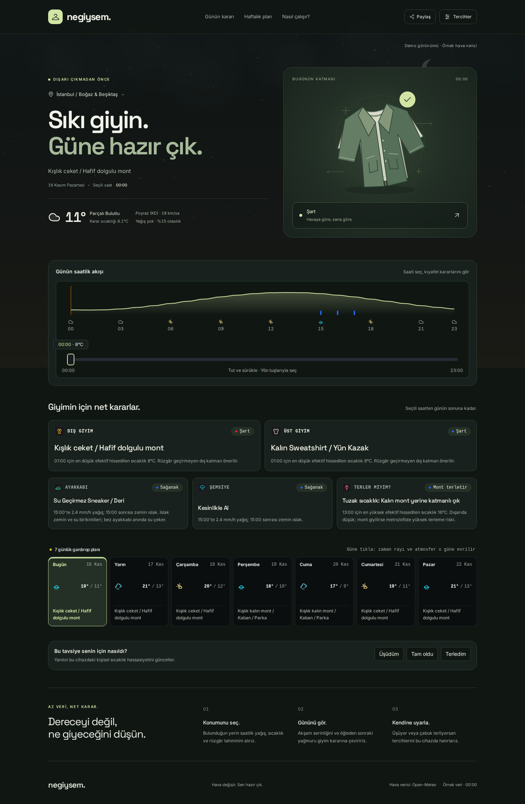
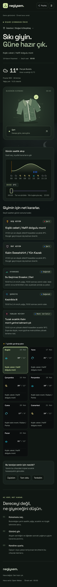

<p align="center"></p>

# Negiysem

**“Bugün ne giysem?” sorusuna, hava tahmininden net bir cevap.**

**[Canlı uygulama](https://negiysem-bice.vercel.app)** · **[Demoyu keşfet](https://negiysem-bice.vercel.app/?demo=1)**

Negiysem; hissedilen sıcaklığı, yağışı ve rüzgârı kişisel giyim kararlarına çevirir. Bir hava durumu tablosundan fazlası: dış giyim, üst giyim, ayakkabı, şemsiye ve konfor için tek bakışta anlaşılır bir plan.

**Next.js 16 · React 19 · TypeScript · Tailwind CSS · Open-Meteo · Playwright**

## İçindekiler

- [Hızlı başlangıç](#hızlı-başlangıç)
- [Neler yapar?](#neler-yapar)
- [Doğrulama](#doğrulama)
- [Yayınlama](#yayınlama)
- [Mimari](#mimari)

## Görünüm



<details><summary>390px mobil görünümü aç</summary>

</details>

Ekran görüntüleri GitHub Actions üzerinde çalışan gerçek Chromium'dan, demo verisiyle alınmıştır.

## Hızlı başlangıç

Node.js **22 LTS** ve npm gerekir. [Doğrulanmış CI koşusu](https://github.com/Bartu-Ercan/negiysem/actions/runs/43882577258): 104 birim testi ve 8 headless tarayıcı testi başarılı. API anahtarı veya `.env` dosyası gerekmez.

```bash
npm ci
npm run dev
```

Uygulama: **http://localhost:3000**

Dış servise bağlanmadan yedi günlük örnek verilerle keşfetmek için: **http://localhost:3000/?demo=1**

```bash
# Üretim derlemesi ve yerel sunucu
npm run build
npm start
```

> Demo veya bağlantı hatasındaki örnek tahmin, arayüzde açıkça işaretlenir. Canlı hava tahmini gibi sunulmaz.

## Neler yapar?

| Özellik | Davranış |
| --- | --- |
| Giyim kararı | Saf, test edilmiş kurallar; açıklanabilir ve tekrarlanabilir sonuçlar |
| Saatlik zaman rayı | Fare, dokunma veya klavyeyle 24 saat arasında seçim |
| Haftalık plan | Yedi gün için aynı karar motorundan öneriler |
| Konum ve GPS | İstanbul mikro-iklimleri, diğer şehirler ve cihazın gerçek koordinatları |
| Kişisel tercihler | Sıcaklık hassasiyeti, süet koruması ve terleme eğilimi |
| Termal geri bildirim | “Üşüdüm / Tam oldu / Terledim” ile cihazda saklanan hassasiyet |
| Paylaşım | Sistem paylaşımı veya panoya kopyalama; gerçek sonuç bildirimi |
| Dayanıklılık | Eski isteği iptal etme, zaman aşımı, yeniden deneme, çevrimdışı örnek görünüm |
| Erişilebilirlik | Native slider/dialog, klavye erişimi ve azaltılmış hareket desteği |

Tasarım; koyu orman tonları, yumuşak adaçayı vurguları, özgün SVG kıyafet çizimi ve dar ekranlarda tam okunabilen kartlardan oluşur. Simgeler SVG'dir; tavsiyeler ellipsis ile kesilmez.

## Doğrulama

```bash
npm test
npm run typecheck -- --incremental false
npm run build

# Headless tarayıcı testleri; ilk çalıştırmada tarayıcıyı indir
npx playwright install chromium
npm run test:e2e
```

- **85 mevcut motor/API testi + 19 sunum, girdi ve demo regresyon testi** korunur.
- Playwright, **1440px masaüstü ve 390px mobil** projelerini çalıştırır.
- Taşma, kesilmiş metin, saat rayı, haftalık seçim, tercih kalıcılığı, modal odağı, Türkçe arama ve hata sonrası toparlanma kontrol edilir.
- `.github/workflows/ci.yml` her push ve pull request için test, build ve headless kontrolleri çalıştırır. Raporlar `browser-report` artifact'ında saklanır.

## Yayınlama

Uygulama, Next.js sunucu rotaları kullandığı için **Node.js destekli** bir host üzerinde çalıştırılmalıdır.

**Vercel:** GitHub reposunu içe aktar; framework **Next.js**, build komutu **`npm run build`**. Ortam değişkeni gerekmez.

**Diğer Node.js hostları:** `npm ci`, `npm run build`, ardından `npm start -- --hostname 0.0.0.0`. Platformun verdiği `PORT` ortam değişkeni Next.js tarafından kullanılır.

GitHub Pages yalnızca statik içerik sunduğu için mevcut API rotalarıyla tam uygulama host'u olarak kullanılmaz.

## Mimari

```text
app/                 Sayfa, hata/yüklenme durumları ve HTTP API rotaları
components/          Arayüz, kıyafet çizimi, canvas ve etkileşimler
hooks/               Tercih kalıcılığı ve native modal yaşam döngüsü
lib/engine/          Saf karar motoru ve SPEC eşikleri
lib/weather/         Open-Meteo istemcisi, lokasyonlar, zaman ve demo verisi
__tests__/           Motor ve sunum birim testleri
e2e/                 Playwright ürün akışı testleri
```

İş kuralları: [docs/SPEC.md](docs/SPEC.md). Tasarım ve uygulama kararları: [handoff/](handoff/).

### API

```text
GET /api/weather?lat=41.0428&lon=29.0077
GET /api/decision?lat=41.0428&lon=29.0077&sensitivity=-1&shoe=suede_sensitive&sweat=normal
```

Koordinatlar doğrulanır; geçersiz girdi **400**, dış servis hatası **502** döndürür. Saatler İstanbul zaman dilimiyle yorumlanır. Tahmin, garanti edilmiş gerçekleşmiş hava durumu değildir.

### Gizlilik

Hesap veya uygulama veritabanı yoktur. Tercihler ve seçilen konum `localStorage` içinde bu cihazda tutulur. GPS yalnızca kullanıcı istediğinde çalışır. Tahmin için koordinatlar uygulamanın API'sine ve Open-Meteo'ya gönderilir. Fontlar Google Fonts üzerinden yüklenir.

Hava verisi: [Open-Meteo](https://open-meteo.com/). Giyin, çık, gününü yaşa.
